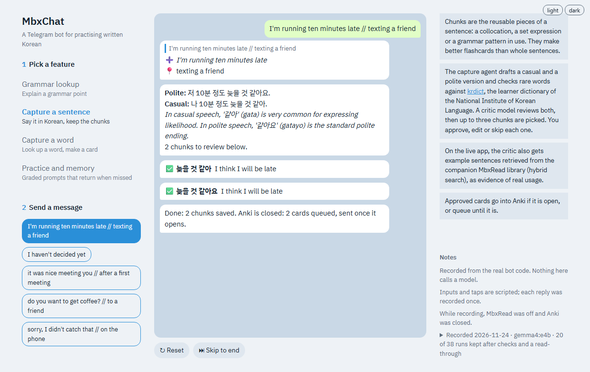
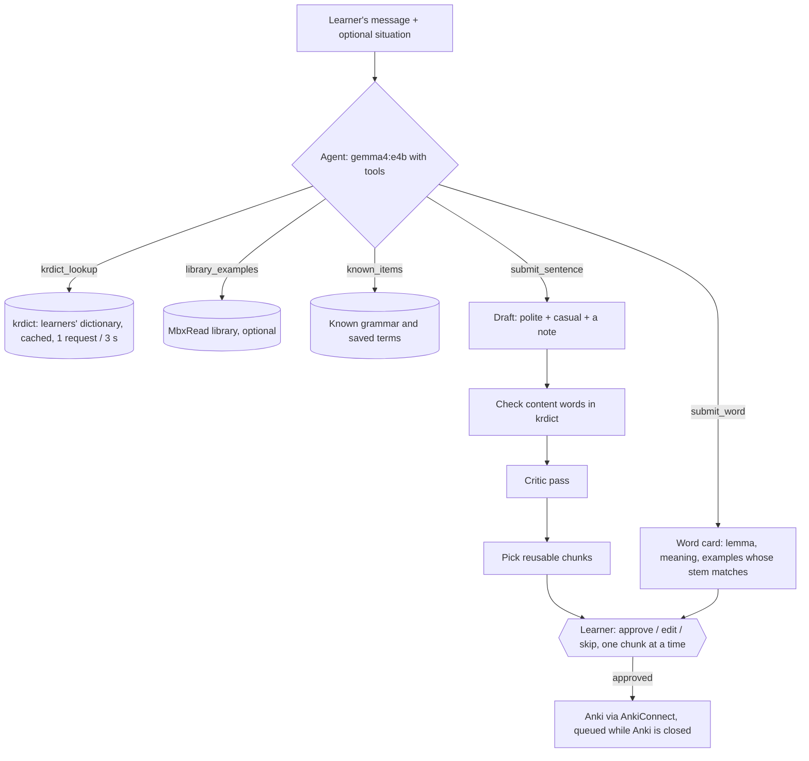
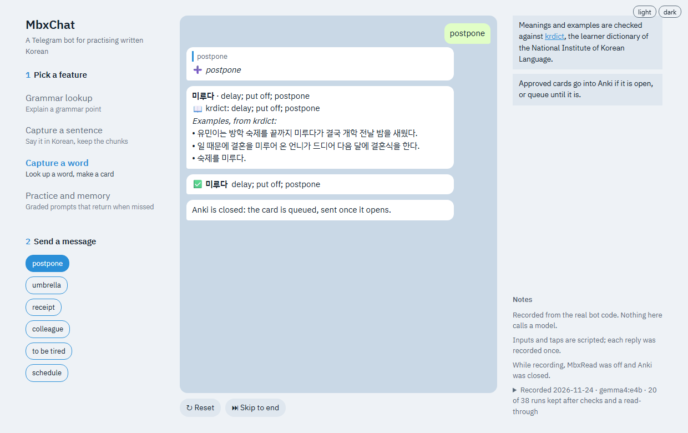
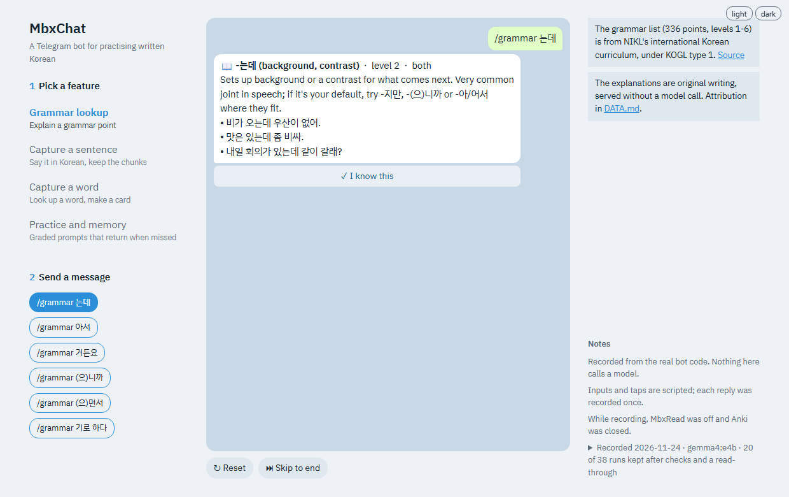
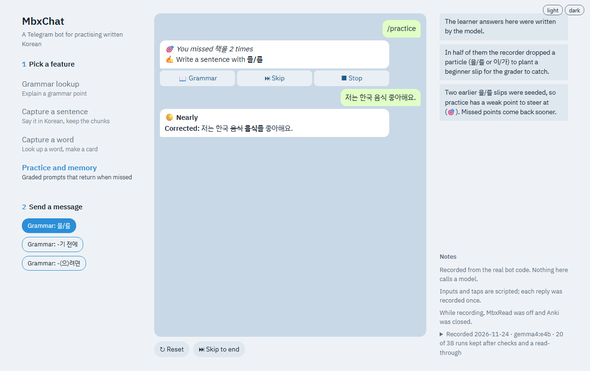
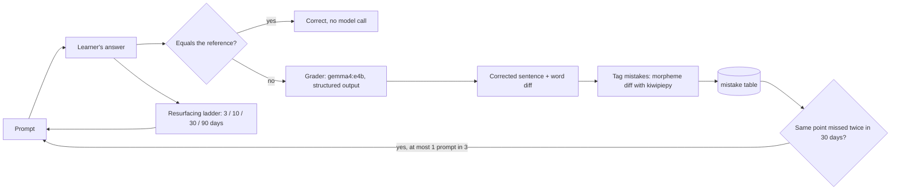
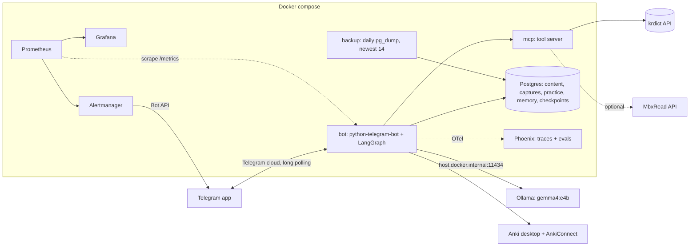
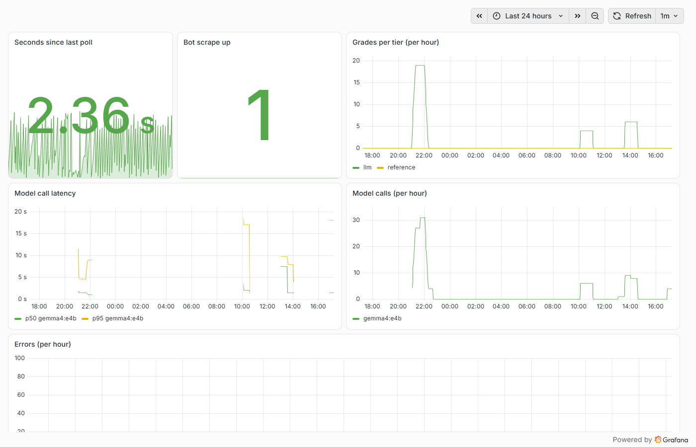

# MbxChat: features and how they work

*Reference doc: the project explainer. Setup and running are in the [README](../README.md);
the contract is [SPEC.md](SPEC.md), the reasons are in [DECISIONS.md](DECISIONS.md).*

MbxChat is a Telegram bot for practising written Korean. It does two jobs: **capture** (the
learner says what they want to say, the bot writes the Korean and makes Anki cards from it)
and **practice** (it sends writing prompts, grades the answers and remembers repeated
mistakes). It runs locally in Docker, with a 4B model through Ollama and no paid API.

**Try it:** [recorded demo](https://miobix.github.io/MbxChat-public/). These are replays of
real bot runs, recorded from the bot's own code; nothing there calls a model.

## Capture: from "how do I say…" to Anki cards

Any text sent to the bot is a capture candidate, and the bot asks before capturing it. A
situation can follow `//` (`can we push the meeting // to my boss`).

A tool-calling agent decides what kind of capture it is and checks its words:

- **Grounded, not trusted:** word cards use dictionary examples whose stem actually matches
  the word, and every example says where it came from (krdict, the MbxRead library, or "model-written,
  unchecked").
- **Human in the loop:** the graph stops at each chunk (`interrupt()`) and waits for a tap.
  LangGraph re-runs a node from its start after an interrupt, so nothing before it has side
  effects; checkpoints live in Postgres, so a restart doesn't lose a capture.
- **Tools behind MCP:** the read-only tools run in a separate MCP server (same image, compose
  network only), so the agent and the tools are separate processes with a narrow interface.
- **The agent earned its place:** compared with the fixed workflow on the same 10 prompts plus
  word prompts, it matched on sentences and won on words (0.8 to 1.9 s and 2 model calls, a real
  dictionary card instead of an echo).

## Grammar lookup

`/grammar 는데` explains a grammar point from the NIKL basic grammar list, with level, register,
short examples and, where it matters, the contrast with a look-alike form. Points marked as
known are skipped.

## Practice: prompts, grading, memory

`/practice` starts a session; pings arrive at set times (`/pause 3h` mutes them). Prompts are
either "write a sentence with this grammar" or "say this in Korean", and each answer is graded
with a word-level diff of the correction.

- **A cost router with a free first tier:** an answer that matches the reference is correct with
  no model call. In practice almost every answer is phrased differently, so nearly all take the
  model path; on a GPU that costs about 1.4 s.
- **Mistakes tagged without a model:** the answer and its correction are split into morphemes
  and aligned; the tags on the fixed side decide the category (particle, ending, spelling,
  spacing, other). It's free, instant and testable offline. Full rewrites become "other" and
  are never steered.
- **Memory that changes what the learner sees:** the same grammar point (or misspelt word) missed twice
  in 30 days becomes a weak point, and at most one prompt in three is steered at it, with a
  visible 🎯 line saying why. `/weak` lists them. Two SQL queries do this; a graph memory
  (Graphiti) was considered and found too heavy for one learner.
- **Variety by rule:** a grammar point at most once per session and once a day, due drills at
  most every other prompt, pool sentences used once and then generated ones.

## Choosing the model

Five local models were scored on a labeled set written for the purpose: 66 learner answers,
18 correct and 48 with known errors, every item proofread. Each run is a Phoenix experiment.

| Model | Verdict right (of 66) | False alarms (of 18) | Missed (of 48) | Correction right | Median s (GPU) |
|---|---|---|---|---|---|
| **gemma4:e4b** | **43** | 2 | 9 | **52** | 1.4 |
| Nemotron-3.5-Bolt-E4B | 43 | 0 | 13 | 48 | 7.0 |
| Qwen3.5-4B | 38 | 8 | 4 | 32 | 2.1 |
| Mi:dm 2.0 Mini | 37 | 1 | 19 | 38 | 0.8 |
| A.X 4.0 Light | 35 | 9 | 6 | 36 | 1.6 |
| dadeum-gec-base (a correction model) | 24 | 0 | 42 | 24 | 0.05 |

gemma4:e4b was the only model with no hard failures as grader or capture writer, and the best
on verdicts and corrections. Qwen missed fewer errors but "corrected" correct answers, sometimes
changing their meaning; Nemotron tied on verdicts but was five times slower and failed 3 of 10
captures. Feeding the correction model's edits to gemma as hints didn't change its scores, so
that tier was dropped. Prompt changes go through the same set: two that read better were
rejected because the numbers got worse (one cut false alarms from 2 to 0 but raised missed
errors from 9 to 16). The [README](../README.md#known-problems) lists what the grader still gets
wrong.

## Architecture

- **No public port:** the bot long-polls Telegram, so nothing listens on the internet. It
  answers one allowlisted Telegram user and ignores everyone else.
- **Content:** the NIKL grammar list (336 points, levels 1 to 6), the NIKL learners' vocabulary
  list (5,543 words), grammar refreshers and graded sentences written for the project. Loaded
  idempotently at every start; sources and licences in [DATA.md](DATA.md).

## Monitoring

The bot serves `/metrics`: grades per grader tier, model call latency and errors per model,
errors reported in the chat, and the time of the last completed Telegram long poll.

- **Liveness is measured where the work happens:** the poll timestamp is stamped by the
  `getUpdates` request itself, so an idle bot (no messages) doesn't look stalled, but a hung
  polling loop does.
- **Alert `BotDown`:** the scrape fails, or no completed poll for 90 s, for 1 minute.
  Alertmanager sends it to the allowed Telegram chat through the Bot API, which works while the bot is
  down. Measured: the alert arrives 83 to 88 s after stopping the bot, the "resolved" message
  about 60 s after starting it.
- **The rule has unit tests:** `promtool test rules` checks stopped, stalled and healthy
  series in CI; raising the threshold makes the test fail.

## The recorded demo

The demo page replays real runs. A recorder drives the bot's actual handlers through a fake
Bot API layer that answers locally and logs every message, edit, button tap and reaction, so
the replay shows exactly what a phone would. Recording uses a scratch database with public
content only, its own tool server with MbxRead off, Anki closed, and the real model and
dictionary.

Every run had to pass before it was shown: automatic checks (no error, the word found in
krdict, a planted slip caught, a clean answer not flagged, no note praising an answer it marked
down, a clean learner sentence) and then a read-through for wrong Korean or contradictions.
**20 of 38 runs passed**; the page says so, and every rejected run is kept in the recording file
with its reason. The learner's practice answers were written by the model, and in half of them
the recorder removed a particle to plant a slip.

Recording in a clean setup also found two bugs that only appear without the author's data: a
generator that wrote "any" into every prompt when no learning words exist, and a grader note
that kept praising an answer after the verdict was lowered. Both are fixed.

## Delivery

- **Tests run offline:** Telegram, the model, krdict, AnkiConnect and MbxRead are faked; each
  test gets a throwaway Postgres database. 153 tests.
- **CI on every pull request:** the test suite, the alert rule tests, the image build and the
  demo build; the demo deploys to GitHub Pages from `main`.
- **Pinned inputs:** Docker images by digest, GitHub Actions by commit SHA, Python dependencies
  locked with hashes, the model checked against its Ollama digest at startup.
- **Hardening passes** at the end of each cycle of units: log census with repeated lines
  counted, table and volume sizes, state after errors, config drift, and a real backup restore
  into a scratch database. Findings and fixes are in DECISIONS.
- **Built in units:** each unit is one branch and one pull request, with the spec, the status
  and the decision log updated in the same change. [SPEC.md](SPEC.md) §8 lists the units.

## Stack

Python 3.14, python-telegram-bot, LangGraph (Postgres checkpointer), LangChain + Ollama,
MCP (FastMCP + langchain-mcp-adapters), kiwipiepy, Postgres 18, Arize Phoenix
(OpenTelemetry), Prometheus, Alertmanager, Grafana, Docker Compose, GitHub Actions + Pages.
