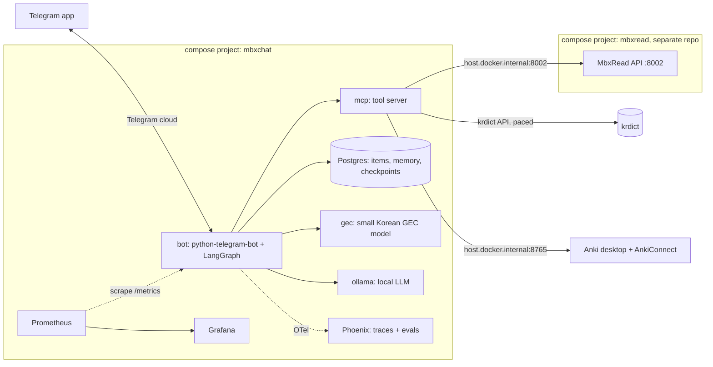

# MbxChat SPEC (contract: what the app is and the units that build it)

*Keep accurate. When the build deviates, change this file in the same commit and log why in
`DECISIONS.md`.*

MbxChat is built in public as an end-to-end agent system: a LangGraph agent with tools,
human-in-the-loop interrupts, an MCP tool server, a cost router over local models, tracing and
evals, and monitoring. It is also used daily by its author, which keeps the design honest.

## 1. What it is

A Telegram bot for practising **written** Korean output. Two loops share one chat:

- **Capture.** "How do I say X?" plus some context. The bot drafts the sentence in two registers
  (casual and polite), checks the words against krdict and against real sentences from the
  user's MbxRead library, has a critic review the drafts, extracts the reusable chunks, and
  proposes Anki cards with **Approve / Edit / Skip** buttons.
- **Practice.** `/practice`, or a scheduled ping. The bot prompts from the item pool, the user
  answers in Korean, a grader corrects and explains, and the next prompt follows. Mistakes steer
  what comes back.

Not in scope: voice (a later unit), a web UI for daily use, multi-user support, paid model APIs.

## 2. Environment

Everything runs in Docker on one PC. Two compose projects share the same Docker engine, so when
Docker Desktop starts, both stacks come back (`restart: unless-stopped`).

- **Telegram long polling:** the bot asks Telegram for updates; nothing listens on a public
  port. Only the allowlisted Telegram user ID gets answers; everyone else is ignored.
- **MbxRead** (sibling project, its own compose stack) is reached at
  `http://host.docker.internal:8002`. MbxRead refuses unknown Host headers, so its `.env`
  `ALLOWED_HOSTS` must include `host.docker.internal`. MbxRead is **optional**: when it is down,
  the tool reports "unavailable" and the agent carries on without library examples.
- **Anki** runs on the desktop; AnkiConnect is reached at `host.docker.internal:8765`, as in
  MbxRead. Card writes queue while Anki is closed.
- **Ollama:** the stack has its own `ollama` service. `OLLAMA_URL` can point at an Ollama that
  already runs on the machine instead, so models are not stored or loaded twice.
- **CPU only.** Every model must be usable on CPU. GPU passthrough gets one timeboxed attempt
  (unit 6); it is a speed-up, never a requirement.

## 3. Fixed constraints

- **No personal data in the repo or the demo.** Captured phrases, imported wishes, saved terms
  and learner memory live in the local database only. Seeds and demo data are written for the
  purpose. `.env` holds the bot token, the allowed user ID and keys; `.env.example` lists them.
- **No paid model APIs.** Open models only. A hosted model is a possible later expansion if CPU
  speed limits real use, and needs its own decision.
- **External APIs are paced, never retried in bursts** (krdict: one request every 3 s, cached,
  stop at the first failure and report it).
- **Failures are reported in the chat**, short and specific; the traceback goes to the logs.
- **Pinned versions:** images by digest, actions by commit SHA, model weights by revision,
  Python dependencies locked.

## 4. Stack

| Concern | Choice | Notes |
|---|---|---|
| Bot | `python-telegram-bot` | long polling; its JobQueue runs the scheduled pings |
| Orchestration | **LangGraph** | `interrupt()` for Approve/Edit/Skip; Postgres checkpointer keyed by chat |
| Structured output | Pydantic models | every model step returns a schema-validated object; invalid output is retried once, then reported |
| Models | open models on CPU | configured in one place; see §6 |
| Tools | MCP server | krdict, MbxRead usage, item pool, Anki; the agent loads them through LangChain's MCP adapters |
| Storage | Postgres | items, learner memory, Anki outbox, LangGraph checkpoints |
| Tracing + evals | **Arize Phoenix**, via OpenTelemetry | one container; swapping to Langfuse is an exporter change |
| Monitoring | **Prometheus + Grafana** | `/metrics` on the bot, one provisioned dashboard, one alert |
| Demo | static page on GitHub Pages | replays seeded conversations; no live model calls |

LangGraph caveat to respect everywhere: a node **re-runs from its start** when resumed after an
interrupt. Side effects before an interrupt (writing a card, sending a message) must be
idempotent.

## 5. Content

Import everything that can be sourced; prune later. Each source gets a provenance entry in
`docs/DATA.md` (source, licence, how to rebuild).

| Source | What | Licence / status |
|---|---|---|
| MbxWrite `data/grammar.tsv` + refreshers | 336 NIKL grammar points, graded 1-6, with explanations and examples | KOGL Type 1 (attribution); refreshers are original writing |
| MbxWrite `data/translations/` | graded sentence pairs | original writing |
| MbxWrite / MbxRead `vocab_levels.tsv` | 5,543 NIKL learner vocabulary lemmas | per MbxRead's provenance entry |
| MbxWrite wishes | phrases the user wanted to say | **personal: local DB only** |
| MbxRead saved terms | words the user saved while reading | **personal: local DB only**, read through MbxRead's API |
| krdict | definitions and example sentences | API terms; cached, paced |

Personal sources are imported by a script that reads from the user's own installs at run time;
nothing personal is committed.

## 6. Models and the cost router

Grading free-form Korean has a real cost/quality trade-off, so the grader is a ladder, cheapest
first:

1. **Rules:** kiwipiepy for spacing and morphology checks. Free, instant.
2. **Small GEC model** (grammatical error correction), candidates `dadeum-gec-base` (KoBART,
   124M) and `Soyoung97/gec_kr`. Fast on CPU.
3. **Local LLM** only for naturalness, register, explanations, or when the cheaper tiers are
   unsure. Candidates: **A.X 4.0 Light** (SKT, 7B, Apache-2.0), `gemma4:e4b`, Mi:dm 2.0 (KT,
   MIT). Licences are checked on each model card before adoption.

Models are configuration entries (name, endpoint, revision/ID, role). **Adding a model that was
not scoped is a planned experiment:** add the entry, run the eval, compare. The eval decides
promotions, not impressions.

## 7. Cards

Long sentences make poor Anki cards. Anki holds the **reusable chunk**; the bot drills whole
sentences.

- One capture yields 0-3 chunk cards (a collocation, an expression, a grammar pattern in use).
- **Front:** a short English gloss, plus the user's original sentence with the chunk blanked.
- **Back:** the Korean chunk, the full Korean sentence, a register note, optionally one MbxRead
  example.
- Approve/Edit/Skip works per chunk. Shape is provisional: adjust after real use.

## 8. Units

Each unit is a branch and a PR, ends green in CI, and updates the docs.

| # | Unit | Done when |
|---|---|---|
| 0 | **Scaffold:** repo, docs, CLAUDE.md, ignore allowlists, locked deps, compose with Postgres, CI (tests + image build), pins | CI green on an empty-but-real app; `docker compose up` healthy |
| 1 | **Bot skeleton:** long polling, allowlist, `/start` `/help`, errors reported in chat, health endpoint | the bot answers the user only, survives a restart, reports a forced error |
| 2 | **Content import:** item schema, NIKL grammar + refreshers, translations, vocab, wishes and MbxRead terms (local only), `docs/DATA.md` | counts match sources; personal rows never in the repo; re-import is idempotent |
| 3 | **Capture as a fixed workflow:** LangGraph graph draft → krdict → MbxRead usage → critic → chunks → interrupt; Pydantic outputs; Phoenix tracing on | a real capture ends in an approved chunk; every step visible in Phoenix |
| 4 | **Anki:** chunk note type, AnkiConnect, outbox while Anki is closed, idempotent adds | approve with Anki closed, open Anki, card appears once |
| 5 | **Practice loop:** `/practice`, pings at 10:00 13:00 17:00 21:00 (configurable), grader, resurfacing ladder (3/10/30/90 days) | a ping arrives on time, an answer gets graded, a miss comes back sooner |
| 6 | **Cost router + model eval:** rules → GEC → LLM, labeled error set, model comparison, GPU attempt (timeboxed) | eval shows quality held on the cheap path and the tier mix; model choice recorded |
| 7 | **The agent:** tutor agent chooses tools and next drill; tools served by the MCP server; eval agent vs unit 3 workflow | agent beats or matches the workflow on the eval, with numbers on latency and calls |
| 8 | **Learner memory:** weak points across sessions steer drills (Postgres first; Graphiti/Zep evaluated) | a repeated mistake visibly changes what practice serves |
| 9 | **Monitoring:** `/metrics`, Prometheus + Grafana, dashboard (calls per tier, latency, errors), alert on stalled polling | stop the bot, the alert fires |
| 10 | **Public demo:** Pages replay of seeded conversations; notes which features are not live (MbxRead examples, Anki) | demo deployed from CI |
| 11 | **Go public:** history and content sweep, README + FEATURES, flip the repo public | sweep finds nothing personal; repo public; demo linked |
| later | Voice answers: Telegram voice note → STT → grade | |

At the end of each cycle (after units 4, 8 and 11): hardening pass and doc roll-up.

## 9. Evals

- **Capture:** chunk extraction and draft quality on a seeded set of English prompts, scored
  against reference answers written for the purpose and proofread by the user.
- **Grader:** a labeled set of learner sentences with known errors (seeded, proofread). Metrics:
  error detection precision/recall, correction accuracy, false alarms on correct sentences,
  latency and tier mix.
- **Agent vs workflow (unit 7):** same inputs, compare quality, latency and number of model calls.
- Datasets and experiment runs live in Phoenix; the labeled files live in the repo.
