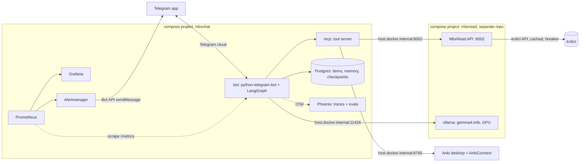

# MbxChat SPEC (contract: what the app is and the units that build it)

*Keep accurate. When the build deviates, change this file in the same commit and log why in
`DECISIONS.md`.*

MbxChat is built in public as an end-to-end agent system: a LangGraph agent with tools,
human-in-the-loop interrupts, an MCP tool server, a cost router over local models, tracing and
evals, and monitoring. It is also used daily by its author, which keeps the design honest.

## 1. What it is

A Telegram bot for practising **written** Korean output. Two loops share one chat:

- **Capture.** "How do I say X?" plus some context. The bot drafts the sentence in two registers
  (casual and polite), checks the words against krdict and against real sentences from the
  user's MbxRead library, has a critic review the drafts, extracts the reusable chunks, and
  proposes Anki cards with **Approve / Edit / Skip** buttons.
- **Practice.** `/practice`, or a scheduled ping. The bot prompts from the item pool, the user
  answers in Korean, a grader corrects and explains, and the next prompt follows. Mistakes steer
  what comes back.

Not in scope: voice messages (Telegram allows them, but audio ingestion is not part of this project), a web UI for daily use, multi-user support, paid model APIs.

## 2. Environment

Everything runs in Docker on one PC. Two compose projects share the same Docker engine, so when
Docker Desktop starts, both stacks come back (`restart: unless-stopped`).

- **Telegram long polling:** the bot asks Telegram for updates; nothing listens on a public
  port. Only the allowlisted Telegram user ID gets answers; everyone else is ignored.
- **MbxRead** (sibling project, its own compose stack) is **optional**: when `MBXREAD_URL` is
  set (e.g. `http://host.docker.internal:8002`), MbxChat uses its material (library example
  sentences, saved terms for practice); unset (the default from unit 7), those features are
  off and silent. MbxChat runs without it for anyone. MbxRead refuses unknown Host headers, so
  its `.env` `ALLOWED_HOSTS` must include `host.docker.internal`. When set but down, the tool
  reports "unavailable" and the agent carries on without library examples.
- **Anki** runs on the desktop; AnkiConnect is reached at `host.docker.internal:8765`, as in
  MbxRead. Card writes queue while Anki is closed.
- **Ollama:** any Ollama at `OLLAMA_URL` (default `host.docker.internal:11434`). The author's
  is MbxRead's compose `ollama` service (GPU, `gemma4:e4b`), shared so the model is not stored
  or loaded twice; anyone else runs their own. The README says so (unit 11).
- **krdict:** until unit 7 it goes through MbxRead's `GET /api/dict`. From unit 7 MbxChat has
  its own client (an MCP tool, `KRDICT_API_KEY`), so it runs without MbxRead: one request every
  3 s, every answer cached in Postgres, all calls stopped after the first failure. Running both
  apps on one IP means two clients; each paces itself, and MbxChat's cache keeps its share small.
- **CPU only.** Every model must be usable on CPU. GPU passthrough gets one timeboxed attempt
  (unit 6); it is a speed-up, never a requirement. Unit 6b got it working (Docker Desktop update):
  gemma grades in ~1.4 s on GPU against ~11 s on CPU.

## 3. Fixed constraints

- **No personal data in the repo or the demo.** Captured phrases, saved terms
  and learner memory live in the local database only. Seeds and demo data are written for the
  purpose. `.env` holds the bot token, the allowed user ID and keys; `.env.example` lists them.
- **No paid model APIs.** Open models only. A hosted model is a possible later expansion if CPU
  speed limits real use, and needs its own decision.
- **External APIs are paced, never retried in bursts** (krdict: one request every 3 s, cached,
  stop at the first failure and report it).
- **Failures are reported in the chat**, short and specific; the traceback goes to the logs.
- **Pinned versions:** images by digest, actions by commit SHA, model weights by revision,
  Python dependencies locked.

## 4. Stack

| Concern | Choice | Notes |
|---|---|---|
| Bot | `python-telegram-bot` | long polling; a 30 s loop in the bot runs the scheduled pings |
| Orchestration | **LangGraph** | `interrupt()` for Approve/Edit/Skip; Postgres checkpointer, one thread per capture |
| Structured output | Pydantic models | every model step returns a schema-validated object; invalid output is retried once, then reported |
| Models | open models on CPU | configured in one place; see §6 |
| Tools | MCP server | read-only: krdict (own client), MbxRead library examples (optional), item pool; the agent loads them through LangChain's MCP adapters. Anki writes stay in code (the outbox), never a tool |
| Storage | Postgres | items, learner memory, Anki outbox, LangGraph checkpoints |
| Tracing + evals | **Arize Phoenix**, via OpenTelemetry | one container; swapping to Langfuse is an exporter change |
| Monitoring | **Prometheus + Grafana** | `/metrics` on the bot, one provisioned dashboard, one alert |
| Demo | static page on GitHub Pages (§7h) | replays recorded conversations; no model calls |

LangGraph caveat to respect everywhere: a node **re-runs from its start** when resumed after an
interrupt. Side effects before an interrupt (writing a card, sending a message) must be
idempotent.

## 5. Content

Import everything that can be sourced; prune later. Each source gets a provenance entry in
`docs/DATA.md` (source, licence, how to rebuild).

| Source | What | Licence / status |
|---|---|---|
| MbxWrite `data/grammar.tsv` + refreshers | 336 NIKL grammar points, graded 1-6, with explanations and examples | KOGL Type 1 (attribution); refreshers are original writing |
| MbxWrite `data/translations/` | graded sentence pairs | original writing |
| MbxWrite / MbxRead `vocab_levels.tsv` | 5,543 NIKL learner vocabulary lemmas | per MbxRead's provenance entry |
| MbxWrite wishes | phrases the user wanted to say | imported once (2026-11-22), captured through MbxChat and dropped (2026-11-24) |
| MbxRead saved terms | words the user saved while reading | **personal: local DB only**, read through MbxRead's API |
| krdict | definitions and example sentences | API terms; cached, paced |

Public pools are committed under `data/` and upserted into one `item` table (kind, key, level,
ko, en, data) at every bot start. Personal sources are imported by `python -m mbxchat.importer`,
run on the host, which reads the user's own installs; nothing personal is committed. Each kind is
replaced as a whole, so re-imports are idempotent and source deletions carry over. **Nothing reads
MbxWrite at run time** (it will not exist in production): its files were copied once (its wishes
were imported, captured and dropped); MbxChat owns the copies.

## 6. Models and the cost router

Grading free-form Korean has a real cost/quality trade-off, so the grader is a ladder, cheapest
first:

0. **Reference match:** the answer equals the reference (spaces and punctuation ignored) → correct,
   no model call.
1. **Local LLM** decides the verdict and explains: `gemma4:e4b`, picked in the unit 6b eval over
   A.X 4.0 Light, Mi:dm 2.0 Mini, Nemotron-3.5-Bolt-E4B and Qwen3.5-4B (Olala-v1.0-mini-7A1B did
   not load). Results and reasons in DECISIONS (2026-11-23). Licences are checked on each model
   card before adoption.

A GEC hint tier (`dadeum-gec-base` fixes passed to the LLM) was evaluated in 6b and dropped: it
edits 6 of 48 learner errors and its hints did not change gemma's scores. `grade()` keeps an
optional `hint` for the eval harness only.

Grading and capture are separate model roles (`GRADER_MODEL`, `CAPTURE_MODEL`); the eval can
pick a different model for each. **Moving hosts:** quality scores carry over (same weights and
quantization give the same answers); latency and what fits in RAM do not. On a new machine,
rerun the harness for latency only and re-pick within the scored models; a stronger machine
makes bigger models a new experiment against the same set.

Models are configuration entries (name, endpoint, revision/ID, role). **Adding a model that was
not scoped is a planned experiment:** add the entry, run the eval, compare. The eval decides
promotions, not impressions.

## 7. Cards

Long sentences make poor Anki cards. Anki holds the **reusable chunk**; the bot drills whole
sentences.

- One capture yields 0-3 chunk cards (a collocation, an expression, a grammar pattern in use).
- **Front:** a short English gloss, plus the Korean sentence with the chunk blanked.
- **Back:** the Korean chunk, the full Korean sentence, a register note. (An MbxRead example is
  deferred: the usage hits are per word, not per chunk.)
- Approve/Edit/Skip works per chunk. Shape is provisional: adjust after real use.

**Delivery (unit 4).** Note type `MbxChat Chunk` (fields Gloss, Blanked, Chunk, Sentence,
Register; created if missing, never modified after) in deck `ANKI_DECK` (default
`MbxChat::Chunks` since unit 12, a sibling of the words deck; the parent `MbxChat` held them before),
through AnkiConnect (`ANKI_URL`). The `chunk` table is the outbox: `anki_note_id` stays null
until Anki has the note. A push runs after each approval, on `/queue`, and every 60 s; Anki
closed → everything stays queued, quietly. Each note is tagged `mbxchat-<chunk uid>` and a push
looks for that tag before adding, so a crash between add and commit never duplicates. A note
Anki refuses is parked (`anki_error`) and listed by `/queue`, not retried. Blanking: kiwipiepy
morphemes of the chunk (final 다 dropped), longest contiguous run found in the sentence's
morphemes; no match → the front shows the gloss only.

## 7a. Commands and chat UI

**Language:** menus, buttons and explanations in English; Korean content stays Korean.
**No persistent reply keyboard:** the `/` menu plus inline buttons keep the chat clean.

| Input | Does |
|---|---|
| `/start`, `/help` | short welcome and what you can do |
| `/practice` | start a practice session (pings start one too) |
| `/stop` | end the session |
| `/pause <duration>` | mute pings for a while (`/pause 3h`) |
| `/grammar <form>` | explainer for one grammar point (`/grammar 는데`) |
| `/queue` | cards waiting for Anki |
| `/stats` | streaks and weak points |
| free text, no session | assumed to be a capture; the bot asks **"Capture this?"** `[➕ Capture] [✖ No]` first |
| free text, in a session | an answer to grade |

Routing is deterministic until unit 7 (an open session decides what free text means); the agent
then takes over ambiguous cases, and the two are compared.

**UI building blocks** (unit 1 builds them, later units reuse them):
- **Inline keyboards edited in place:** a tapped proposal becomes its outcome ("✅ Saved") in the
  same message, buttons removed; a short toast confirms the tap. Callback data is a short key
  (≤ 64 bytes, Telegram's limit) pointing at state in Postgres, never the payload itself.
- **Live progress message:** one status message edited as work advances ("Checking spelling…
  → Grammar model… → Writing feedback…") plus the typing indicator, so slow CPU steps are
  visible and the router's tiers show.
- **Teaching format (HTML):** corrections as strikethrough → bold, model answers under a spoiler
  (tap to reveal), long explanations in a collapsible quote, a 👍 reaction on correct answers.
- **Edit flow:** ✏️ returns the draft with a copy button; the user pastes, edits, sends.
- **`/` menu set by the bot at startup, scoped to the allowed chat**: strangers see no commands.
- A Telegram Mini App is out of scope; reconsider for `/stats` charts.

## 7b. Grammar explainer

Built on the NIKL grammar pool and its refreshers (explanation, 2-3 examples, register,
"vs X" contrast), so it needs no model call.

- **`/grammar <form>`** matches the form loosely (with or without the leading `-`, either
  allomorph: `은`, `는`, `은/는`). Several matches (the same form at two levels with different
  senses) → inline buttons to pick one.
- **In practice:** a prompt that targets grammar points carries a `[📖 Grammar]` button; tapping
  it expands their explainers in place (collapsible quotes).
- **Basics are skipped:** points marked basic are never offered for explanation. Seeded with a
  short hand-picked list of level-1 particles (이/가, 은/는, 을/를, 에, 에서, 도, 와/과, 의, …)
  on the first import, then grown by a `[✓ I know this]` button on any explainer. Asking for a
  known point offers `[↩ Not known]`, which takes it off the known pile and explains it. A known point
  that the user keeps getting wrong comes back (learner memory, unit 8).
- Optional later: an extra example from the user's MbxRead library, if its index can find
  sentences by grammar ending.

## 7c. Capture workflow (unit 3)

A LangGraph `StateGraph`, one thread per capture (`thread_id` = `capture.id`), Postgres
checkpointer. Nodes:

1. **draft** (LLM): the user's text → `Draft {casual, polite, note}`.
2. **lookup**: kiwipiepy lemmas of the drafts' content words. Lemmas outside the NIKL word pool
   are checked against krdict (via MbxRead); up to two of the rarest lemmas get library usage
   from MbxRead `POST /api/usage` (2 hits each). Either source down → noted, not fatal; krdict
   stops at its first failure.
3. **critic** (LLM): drafts + findings → `Review {casual, polite, issues}`.
4. **chunks** (LLM): reviewed drafts → `Chunks {items: 0-3 × {ko, gloss, kind, register_note,
   sentence}}`.
5. **review**: one `interrupt()` per chunk, resumed with approve / edit (new Korean) / skip. No
   side effects here, so re-running it on resume is safe.
6. **save**: approved chunks into `chunk` (unique on capture + Korean, so a re-run adds nothing).

Model steps use Pydantic schemas through Ollama structured output, thinking off; invalid output
is retried once, then the capture fails with a message in the chat. The bot drives the graph:
it streams node updates into the progress message, and sends one card per interrupt (callback
`ch:<capture>:<chunk>:<action>`). ✏️ answers with a copy button; the next text the user sends
is the edited chunk. Tracing: OpenInference's LangChain instrumentation to Phoenix
(`127.0.0.1:6006`) when `PHOENIX_COLLECTOR_ENDPOINT` is set.

**Situation:** text after `//` in a capture is the situation (`capture.situation`), shown to
draft, critic and chunks. The reviewed polite/casual pair is stored on `capture` by `save`, as
the practice reference.

## 7d. Practice loop (unit 5)

Plain code, no graph (one model call, no pause inside it).

- **Session:** `/practice` or a ping opens one (Postgres `session`); it closes on `/stop`, ⏹, or
  after 30 min without activity. While open, free text is the answer to the waiting prompt; the
  graded reply is followed by the next prompt. Outside a session, a prompt from the last 12 h
  can still be answered: "Capture this?" then offers `[✍️ It's my answer to the last prompt]`.
- **Prompts** (`prompt` table, buttons `[📖 Grammar] [⏭ Skip] [⏹ Stop]`, Grammar only when the
  prompt has a grammar point): **translate** (graded sentences with their reference answer, then
  generated ones, §7f) and **grammar** (a NIKL point not marked known,
  levels 1-4 before 5-6, random among the undrilled, plus a random MbxRead term in `learning`).
  New items alternate between the two kinds. Nothing is prompted twice within a day.
- **Ladder** (`drill`, one row per grammar point since unit 8, §7f): oldest due first. correct → next
  step, due in 3/10/30/90 days (90 repeats); minor → same step, same interval; wrong → step 0,
  due in 3 days. Skip pushes the grammar point to tomorrow at the earliest.
- **Grader:** one `gemma4:e4b` call, `Grade {issues, corrected, model_answer, note, verdict}`
  (verdict last, so it follows the listed errors). A "correct" whose corrected sentence differs
  (ignoring spaces and punctuation) becomes "minor". Shown as verdict, corrected sentence,
  issues, model answer under a spoiler, the note (folded when long), 👍 on correct. The corrected
  line is a word diff against the answer (<s>old</s> <b>new</b>); the model answer is left out
  when it equals the corrected sentence (unit 6a).
- **Pings:** `PRACTICE_PINGS` (default 10:00, 13:00, 17:00, 21:00) in `PRACTICE_TZ`. A ping fires
  once (the last one sent is stored in `setting`), never more than 30 min late (after
  downtime it is skipped), and not while a session is open or `/pause` is active.
  `/pause 3h|30m|2d`, `/pause off`, `/pause` alone shows the state.

## 7e. Capture agent (unit 7)

A LangGraph tool-calling agent takes the front of capture, behind `CAPTURE_MODE`
(`workflow` | `agent`; default `agent` since the unit 7 eval). Model: `gemma4:e4b` (in the
tool-calling check, 20 of 20 runs valid, right path every time, 0.65 s median; no model router).

- **The agent decides:** what kind of capture this is (a **word**: "the word for optimization";
  or a **sentence**), the Korean (word choice, the two drafts), and what to do with what the
  tools return. krdict is a learners' dictionary and misses many work words (최적화 returned
  nothing, while its root 최적 is listed): a word path with no entry may look up the root once
  (dropping -화, -하다, -되다, -적), keeps the word, says "not in the learners' dictionary; root
  최적 = optimum", and leans on library or marked model-written examples; a sentence draft's unknown word is
  still a reason to reconsider it.
- **Grounding is enforced, not chosen:** in the check, given the choice, the model skipped the
  dictionary on 19 of 20 sentence captures and wrote its own examples for 9 of 10 words. So code
  always runs the dictionary check on the chosen word (or the drafts' rare lemmas) and fetches
  library examples when MbxRead is configured, and the agent sees the results before it submits.
- **Word path:** `submit_word {korean, english, examples}`, then `word_lookup` (fixed), then one
  card proposal `[✅ Approve] [⏭ Skip]` (an interrupt), then `word_save` into the `word_card`
  outbox. Up to 3 examples, in this order (user, 2026-11-23): library hits that are **full
  sentences** (transcript fragments are dropped), else krdict's examples of the entry (one more
  request), else the model's, labelled "model-written, unchecked". Note type `MbxChat Word`
  (English front; Korean, Dictionary, Examples back), deck `ANKI_WORD_DECK` (default
  `MbxChat::Words`), pushed by the same loop as chunks, tagged `mbxchat-<uid>`. Before adding,
  `findNotes` looks for the Korean word in that deck under any note type with a Korean field
  (MbxRead's included): found → "Already in <deck>: nothing added". The capture is marked
  `kind = 'word'`, so practice never prompts it; word cards are Anki-only.
- **Sentence path (hybrid):** `submit_sentence` marks the capture a sentence; the agent's own
  draft is dropped and the whole unit 3 chain runs (draft → lookup → critic → chunks → review →
  save). In the eval the agent's drafts were flatter than the workflow's, with no tool use.
- **Session routing** (all modes, `practice.route`): inside an open session, mostly-Hangul text
  is an answer and is graded with no extra call (answers are Korean; phrases to capture are
  English, and questions are asked in English, user 2026-11-23). A single Korean word (no
  space) is a word heard somewhere: offered with `[➕ Capture]` first, no call. Anything else gets one
  structured call (answer / capture / question). Anything not an answer is offered, never run:
  `[➕ Capture] [💬 Answer it]` (the guess only orders them and picks the wording) and
  `[✍️ Grade it as my answer]`. "Answer it" is one model call (`practice.explain`), told not to
  give away the task; the prompt stays waiting. A routing failure falls back to grading. Live
  check: "how do I say I am stuck in traffic" was guessed as a question, which is why all
  options are always shown.

## 7f. Learner memory and prompt variety (unit 8)

Practice (amends §7d):

- **Captures are never prompted back:** they are already in Anki. Old `capture` rows in `drill`
  are ignored, not deleted. The late-answer path (`[✍️ It's my answer to the last prompt]`) stays.
- **The ladder tracks grammar points; sentences are new each time.** A grade moves the `drill`
  row of the prompt's grammar point (a prompt without one moves nothing). Translate prompts come
  from the graded sentences, each used once, then are generated: one model call
  (`Generated {en, formality}`) writes an English sentence that needs a new grammar point and a
  `learning` term. No situation line: the model kept naming the grammar in it. A generated
  prompt has no reference answer and is never shown again. A failed generation serves that
  grammar point as a grammar prompt.
- **Spacing out:** wrong → step 0, due in 3 days. A due drill takes at most every other prompt;
  new items are random within the level order. A grammar point is prompted at most once per
  session and once a day (pool sentences included, by their grammar point).

Learner memory (Postgres, no extra model call):

- **Mistakes:** each grade diffs the answer against the corrected sentence (kiwipiepy morphemes,
  plus a word diff for spacing) into `mistake {prompt_id, category, wrong, fix, grammar_id}`.
  Categories, judged on the fixed side: `particle`, `ending`, `spelling` (a span a few jamo
  away), `spacing`, `other` (rewrites). A particle or ending whose form, or a NIKL `related`
  variant, matches a grammar point gets its `grammar_id` (so 을 and 를 are one point). A tagging
  failure is logged and never costs the grade.
- **Weak point:** the same grammar point (or, without one, the same category and fix) at least
  twice in 30 days, not used cleanly since (a later correct answer on the grammar point, or the
  word written right). `other` is never a weak point.
- **Steering:** at most one prompt in three. A weak grammar point not prompted in the last 3 days
  is served as a grammar prompt; a weak spelling word becomes the word of a grammar prompt. The
  prompt carries one line, e.g. `🎯 You missed 담당자 2 times`. Spacing slips, and particles or
  endings with no grammar point, show only in `/weak`.

## 7g. Monitoring (unit 9)

- **`/metrics`** on the health server (`:8005`, `prometheus_client`):
  `mbxchat_grades_total{tier=reference|llm}` (the §6 ladder), `mbxchat_model_call_seconds{model}`
  and `mbxchat_model_errors_total{model}` (one LangChain callback on every `ChatOllama`: grader,
  capture, router, agent), `mbxchat_errors_total` (errors reported in the chat) and
  `mbxchat_last_poll_timestamp_seconds` (stamped by the `getUpdates` request after every
  completed long poll, empty or not).
- **Compose:** `prometheus` (scrape 15 s, 30-day retention, `127.0.0.1:9090`), `grafana`
  (`127.0.0.1:3005`, no login, provisioned datasource and the `MbxChat` dashboard from
  `monitoring/grafana/`), `alertmanager` (compose network only).
- **Alert `BotDown`:** `up == 0` or the last poll older than 90 s, for 1 minute. Alertmanager
  sends it, and its resolution, to the allowed chat through the Bot API with the bot's token
  (works while the bot is down). Rule tests: `monitoring/alerts_test.yml` (`promtool`, in CI).

## 7h. Recorded demo (unit 10)

- **What it is:** `demo/index.html`, one static page with no build step, that replays
  `demo/conversations.json` as a Telegram-style chat. Four groups (grammar lookup, sentence
  capture, word capture, practice with a steered weak point), each a pool of input chips: picking
  one plays its recording and greys the chip out; Reset brings them back. It calls no model and
  takes no free input; it says so, names what a replay leaves out (MbxRead examples, Anki) and
  shows how many recorded runs were kept.
- **Layout:** three columns, the chat alone in the middle. Left: "1 Pick a feature" (the four
  groups, each with a one-line description) over "2 Send a message" (the chips). Right: the
  group's notes as shaded lines, then a plain "Notes" block shared by all groups. One column on
  narrow screens. Light and dark themes, starting from the system setting, switchable by two
  buttons. A group's `note` is a list of lines and may hold links (it is the repo's own text).
- **Recording:** `demo/record.py` drives the real handlers (`build_app`) with a fake Bot API
  request that answers locally and logs every send, edit, tap, reaction and toast, with times.
  Scratch database `mbxchat_demo` (public pools only, plus two seeded 을/를 slips), its own MCP
  server without MbxRead, Anki unreachable, the real model and krdict. Practice answers are written
  by the model; for half of them the recorder drops the first 을/를 (else 이/가) with kiwipiepy to
  plant a slip. Rerun after any change to what the bot sends:
  `docker compose up -d --build`, then
  `docker compose run --rm --no-deps -v "$(pwd -W)/demo:/app/demo" bot python -m demo.record [group prefix ...]`
  (a prefix such as `Practice` re-records only that group).
- **Quality gate:** a run is kept only if it passes automatic checks (no ⚠️ or failure, the word
  found in krdict, at least one chunk, a planted slip not graded correct, a clean answer graded
  correct, no note praising an answer it marked down, a learner answer that is one clean Korean
  sentence) and then a human read for wrong Korean or contradictions. A rejected run is moved with
  its reason: `DATABASE_URL=postgresql://unused@127.0.0.1:1/x python -m demo.record drop "<label>" "<reason>"`.
  Dropped runs and reasons stay in the JSON (`dropped`).
- **CI:** the `demo` job builds the site on every run; `pages` deploys it from `main` only when
  the repo is public. `tests/test_demo.py` replays the events against what was on screen (every
  tap hits a button that existed).

## 7i. Words from practice (unit 12)

Real use: a grammar prompt's word was unknown (its MbxRead gloss was too short to help),
and translate prompts send the learner asking "what's <English word> in Korean?" through
"Answer it", which can't save anything. Both now end in the §7e word path (krdict check, card
proposal, `ANKI_WORD_DECK`), with no new lookup or Anki code.

- **`[🔤 <word>]` on grammar prompts that carry a word**, next to `[📖 Grammar]`: runs a capture
  of the bare Korean word (the term without its gloss), the same input as a single Korean word
  typed in a session. The prompt stays waiting.
- **Card offer after "Answer it":** `Explanation` gains a required `word`, the Korean word the
  question is about (its meaning, or the Korean for an English word), empty otherwise. The
  model fills it for most questions, so code decides (`Explanation.card`): the word's leading
  Hangul run; an English question trusts it, a Korean question must name exactly one Korean
  word sharing its first syllable (꿈꿔요 → 꿈꾸다), two or more (a comparison) get none. When
  there is a word, the answer carries `[➕ Save <word> as a card]`, which runs the same capture.
- **No LaTeX in replies:** `ask()` cleans every string field the model returns: common LaTeX
  arrows and symbols (`\rightarrow`, `\to`, `\leftarrow`, `\times`) become their Unicode
  characters and leftover `$` math delimiters are dropped (a live explanation showed
  `$\rightarrow$`).
- **Decks:** chunks (phrases) and words are separate study decks. Chunks moved from the parent
  `MbxChat` (which Anki studies together with its subdecks) to `MbxChat::Chunks`; the 13
  existing chunk notes are moved once with AnkiConnect `changeDeck`, words stay in
  `MbxChat::Words`.
- **Demo:** a headless-Chrome test loads each demo scene and checks the chat renders (it skips
  without Chrome locally, fails without it in CI); README and demo link Anki.

## 8. Units

Each unit is a branch and a PR, ends green in CI, and updates the docs.

| # | Unit | Done when |
|---|---|---|
| 0 | **Scaffold:** repo, docs, CLAUDE.md, ignore allowlists, locked deps, compose with Postgres, CI (tests + image build), pins | CI green on an empty-but-real app; `docker compose up` healthy |
| 1 | **Bot skeleton + UI kit:** long polling, allowlist, `/start` `/help`, per-chat `/` menu, errors reported in chat, health endpoint, the §7a building blocks with a small demo each | the bot answers the user only, survives a restart, reports a forced error; buttons edit in place on the phone |
| 2 | **Content import + `/grammar`:** item schema, NIKL grammar + refreshers, translations, vocab, wishes and MbxRead terms (local only), `docs/DATA.md`; the grammar explainer with basics skipped (§7b) | counts match sources; personal rows never in the repo; re-import is idempotent; `/grammar 는데` answers on the phone |
| 3 | **Capture as a fixed workflow:** LangGraph graph draft → krdict → MbxRead usage → critic → chunks → interrupt; Pydantic outputs; Phoenix tracing on | a real capture ends in an approved chunk; every step visible in Phoenix |
| 4 | **Anki:** chunk note type, AnkiConnect, outbox while Anki is closed, idempotent adds; nightly Postgres backups (hardening) | approve with Anki closed, open Anki, card appears once |
| 5 | **Practice loop:** `/practice`, `/stop`, `/pause`, pings at 10:00 13:00 17:00 21:00 (configurable), grader, resurfacing ladder (3/10/30/90 days), `[📖 Grammar]` on prompts; capture context (text after `//` is the situation, stored and passed to draft, critic and chunks) | a ping arrives on time, an answer gets graded, a miss comes back sooner |
| 6a | **Eval groundwork:** model shortlist with reasons, labeled grading set (`evals/grader_set.md`, written for the purpose, proofread by the user), corrected line shown as a word diff | set drafted and in the repo; diff live on the phone |
| 6b | **Cost router + model eval** (after the proofread): harness with runs in Phoenix, the shortlist on the set, side-by-side capture pass, reference-match router (GEC hints tested and dropped), GPU attempt (timeboxed) | eval shows quality held on the cheap path and the tier mix; grader and capture models chosen and recorded |
| 7 | **The agent** (§7e): capture as a tool-calling agent (word and sentence captures, enforced grounding), word cards to `ANKI_WORD_DECK`, read-only tools on the MCP server with MbxChat's own krdict client, MbxRead off unless `MBXREAD_URL` is set, free-text routing in a session; eval agent vs unit 3 workflow | agent matches or beats the workflow on the capture eval, with numbers on latency and calls; a word capture lands a card in Anki |
| 8 | **Learner memory:** weak points across sessions steer drills (Postgres first; Graphiti/Zep evaluated); the agent choosing the next drill is considered here, once practice data exists (moved from unit 7) | a repeated mistake visibly changes what practice serves |
| 9 | **Monitoring:** `/metrics`, Prometheus + Grafana, dashboard (calls per tier, latency, errors), alert on stalled polling | stop the bot, the alert fires |
| 10 | **Public demo:** Pages replay of seeded conversations; notes which features are not live (MbxRead examples, Anki) | demo built in CI; the deploy job runs once the repo is public (unit 11), since GitHub Free serves Pages from public repos only |
| 11 | **Go public:** history and content sweep, README + FEATURES, a sanitized public copy (`miobix/MbxChat-public`, made with filter-repo; this repo stays private) | sweep finds nothing personal; public repo live; demo deployed and linked |
| 12 | **Real-use notes** (§7i): `[🔤 word]` on grammar prompts and a card offer after "Answer it", both through the §7e word path; LaTeX cleaned from model text; chunks to `MbxChat::Chunks`; demo browser smoke test, Anki links | tapping 🔤 on a prompt and saving a word asked about in "Answer it" each land a card in `MbxChat::Words`; no chunk left in the parent deck; a broken demo replay fails CI |

At the end of each cycle (after units 4, 8 and 11): hardening pass and doc roll-up.

## 9. Evals

- **Capture:** chunk extraction and draft quality on a seeded set of English prompts, scored
  against reference answers written for the purpose and proofread by the user.
- **Grader:** a labeled set of learner sentences with known errors (seeded, proofread). Metrics:
  error detection precision/recall, correction accuracy, false alarms on correct sentences,
  latency and tier mix.
- **Agent vs workflow (unit 7):** same inputs, compare quality, latency and number of model calls.
  Inputs: the 10 capture side-by-side prompts plus word prompts, judged side by side by the user;
  tool-calling mechanics checked by `evals/tool_calling.py`.
- Datasets and experiment runs live in Phoenix; the labeled files live in the repo. Items marked
  `check: pending` (written, not yet proofread) run only with `--with-pending`, into separate
  result files.
